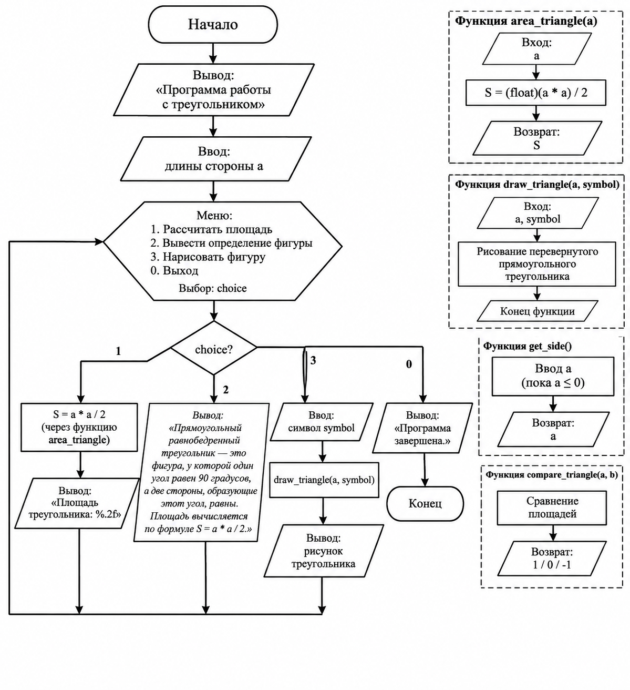

## ДОМАШНЕЕ ЗАДАНИЕ К РАБОТЕ 10

## Уcловие

Разработать программу с использованием собственных функций для вычисления площади, вывода определения и рисования геометрической фигуры.

## 1 Алгоритм работы и блок схема

1. Начало программы.
2. Ввод длины стороны треугольника.
3. Вывод меню выбора операции.
4. Пользователь выбирает одну из операций:
   - Рассчитать площадь треугольника.
   - Вывести определение фигуры.
   - Нарисовать треугольник.
5. Выполнение выбранной операции
6. Вывод результата.
7. Возврат к меню или завершение программы.

## Используемые функции

- `area_triangle()` — вычисление площади треугольника.
- `draw_triangle()` — рисование треугольника.
- `get_side()` — ввод размера стороны.
- `compare_triangle()` — сравнение двух треугольников по площади.

## Блок-схема 

[Открыть блок-схему](images/block_scheme.png)

## 2. Реализация программы

## 3 Результат работы программы 

 Программа  вычисления площади треугольника, вывод его определения и рисование фигуры с помощью символов. Также создано меню для выбора операций.

## Информация о разработчике 
                                Запорин Артём, бТИИ-262